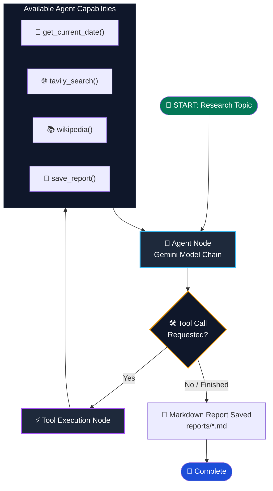
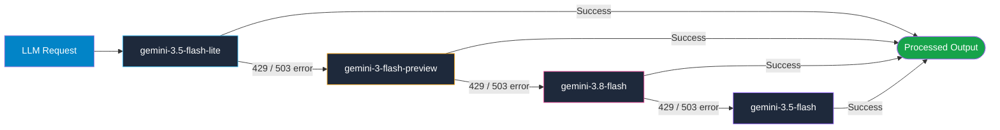

<div align="center">

# 🧠 Autonomous Research Agent

### Single-agent research engine powered by **LangGraph**, **Google Gemini**, and **Tavily Search** with **Multi-Model Fault Tolerance**.

[](https://python.org)
[](https://langchain-ai.github.io/langgraph/)
[](https://ai.google.dev/)
[](https://tavily.com/)
[](https://www.docker.com/)
[](LICENSE)

<br />

<p align="center">
  <a href="#-architecture--workflow">Architecture</a> •
  <a href="#-key-features">Key Features</a> •
  <a href="#-quick-start">Quick Start</a> •
  <a href="#-docker-deployment">Docker</a> •
  <a href="#-environment-variables">Configuration</a> •
  <a href="#-sample-reports">Sample Reports</a>
</p>

</div>

---

## 📌 Overview

The **Autonomous Research Agent** is a dedicated single-agent research engine designed to investigate topics, synthesize findings across real-time web search and verified encyclopedia knowledge bases, and automatically compile structured, executive-grade Markdown reports.

Unlike fragile linear LLM prompt chains, this agent runs on a **cyclic LangGraph state machine** equipped with **Multi-Model Fallback Failover**—automatically circumventing Google Free-Tier rate limits (`429 RESOURCE_EXHAUSTED` and `503 UNAVAILABLE`) in real time.

---

## 🏛 Architecture & Workflow

### End-to-End System Flowchart

<div align="center">
  
</div>

### Interactive State Graph



### Resilient Multi-Model Failover Architecture

Free-tier LLM APIs impose strict daily token and request limits. To guarantee 99.9% task completion without manual intervention, the agent uses LangChain's `with_fallbacks` architecture:



---

## ✨ Key Features

| Capability | Description |
| :--- | :--- |
| **🔄 Cyclical LangGraph Graph** | Implements standard state reduction (`add_messages`), checkpoint memory (`MemorySaver`), and self-correcting loops until research goals are met. |
| **🛡️ Zero-Downtime Model Fallbacks** | Cascades through 4+ Gemini Flash variants on `429` (Quota Exhausted) or `503` (High Demand) within 3 seconds. |
| **🔍 Multi-Vector Sourcing** | Combines real-time web grounding via **Tavily AI Search** with deep background verification via **Wikipedia API**. |
| **📅 Temporal Anchoring** | Automatically verifies current system date before querying so the agent distinguishes historical records from recent breakthroughs. |
| **📊 Structured Markdown Exporter** | Synthesizes findings into comprehensive Markdown files containing Executive Summaries, Key Findings, Comparative Tables, and Verified Citations. |
| **🐳 Containerized & Cloud-Ready** | Pre-configured `Dockerfile` and `docker-compose.yml` with persistent host volume mounts for instant reproduction. |

---

## 📂 Project Structure

```text
research-agent/
├── .env.example                     # Environment template with API instructions
├── .gitignore                       # Production Git rules (protects keys & environments)
├── .dockerignore                    # Build optimization rules for Docker
├── Dockerfile                       # Multi-stage container recipe
├── docker-compose.yml               # Single-command orchestration with volume mounts
├── requirements.txt                 # Exact, verified Python dependencies
├── main.py                          # Core LangGraph agent & tool definitions
├── assets/
│   ├── architecture-diagram.svg     # High-resolution vector flowchart
│   └── architecture-diagram.pdf     # Vector PDF schematic
└── reports/                         # Destination directory for generated research
    ├── .gitkeep                     # Preserves directory in git
    └── state_of_ai_agents_2026.md   # Sample research report generated by agent
```

---

## 🚀 Quick Start

### 1. Prerequisites
- Python 3.10+ (Tested up to Python 3.14) or Docker
- [Google Gemini API Key](https://aistudio.google.com/app/apikey) (Free)
- [Tavily Search API Key](https://tavily.com) (Free tier includes 1,000 monthly queries)

### 2. Local Installation

```bash
# 1. Clone your repository
git clone https://github.com/your-username/research-agent.git
cd research-agent

# 2. Create and activate a virtual environment
python3 -m venv .venv
source .venv/bin/activate  # On Windows: .venv\Scripts\activate

# 3. Install dependencies
pip install -r requirements.txt

# 4. Configure your environment variables
cp .env.example .env
```

Open `.env` and paste your keys:
```env
GOOGLE_API_KEY="AIzaSy..."
TAVILY_API_KEY="tvly-..."
```

### 3. Run the Agent

Run with the default topic:
```bash
python main.py
```

Or pass any custom research query directly via CLI:
```bash
python main.py "Breakthroughs in Solid-State Batteries in 2026"
```

The completed report will be saved automatically into the `reports/` folder.

---

## 🐳 Docker Deployment

The application is fully containerized. Reports generated inside the container are mounted directly to your local `./reports/` directory.

### Using Docker Compose (Recommended)

1. Make sure your `.env` file is configured:
   ```bash
   cp .env.example .env
   ```

2. Run with default topic:
   ```bash
   docker compose run --rm research-agent
   ```

3. Run with a custom topic:
   ```bash
   docker compose run --rm research-agent "Quantum Computing Roadmap 2026"
   ```

### Using Plain Docker CLI

```bash
# Build the image
docker build -t research-agent .

# Run with environment and mounted reports folder
docker run --rm \
  --env-file .env \
  -v $(pwd)/reports:/app/reports \
  research-agent "Global Semiconductor Supply Chain 2026"
```

---

## ⚙️ Environment Variables

| Variable | Required | Default | Description |
| :--- | :---: | :---: | :--- |
| `GOOGLE_API_KEY` | **Yes** | — | Google AI Studio API key used for Gemini reasoning models. |
| `TAVILY_API_KEY` | **Yes** | — | Tavily Search API key used for real-time web querying. |
| `GEMINI_MODEL` | No | `gemini-3.5-flash-lite` | Preferred starting model before triggering fallback chain. |

---

## 📝 Sample Report Output

Each generated report is saved as an individual Markdown document formatted with standard sections:

```markdown
# Comprehensive Report: Current State of AI Agents in 2026

## Executive Summary
Over 40% of enterprise software applications embed task-specific AI agents...

## Key Findings
- 57% of deploying enterprises use multi-agent systems (MAS) rather than monolithic prompts.
- Model Context Protocol (MCP) standardized tool connectivity across major providers.
...

## Detailed Analysis
[Detailed thematic breakdowns, metrics, and architecture comparisons]

## Sources
- [Gate AI: Agent Model Benchmarks 2026](https://gate.ai/...)
- [Google Cloud Agentic Enterprise Study](https://cloud.google.com/...)
```

See [reports/state_of_ai_agents_2026.md](reports/state_of_ai_agents_2026.md) for a full example.

---

## 📤 Pushing to GitHub

To publish this repository to your GitHub account:

```bash
# 1. Initialize Git (if not already done)
git init -b main

# 2. Stage all project files (verifying .env and .venv are ignored)
git add .

# 3. Check staged files
git status

# 4. Make initial commit
git commit -m "feat: initial commit of autonomous research agent"

# 5. Link to your GitHub repository
git remote add origin https://github.com/<your-username>/<your-repo-name>.git

# 6. Push to main branch
git push -u origin main
```

---

## 📜 License

This project is open-source and licensed under the [MIT License](LICENSE).
